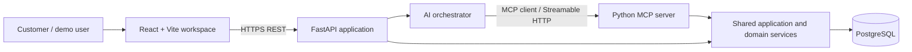

# ReturnPilot System Architecture

**Status:** Planned. This is a modular monolith, not a deployment claim.

## Context and component boundaries



The FastAPI app and MCP server are two entry points in one Python codebase, sharing service modules, configuration, SQLAlchemy models/session factory, and the same PostgreSQL database. For a simple local MVP they may run as separate processes: FastAPI serves the web REST API and hosts orchestration; a dedicated MCP entry point serves Streamable HTTP. The orchestrator's MCP client connects to the MCP server's configured HTTP endpoint. This is a genuine protocol server and is independently initialized, discovered, and invoked; REST endpoints do not satisfy MCP. Separate processes preserve a clear protocol boundary without adding a separate service codebase, independently duplicated rules, or another database. If deployment constraints make it simpler, hosting both transports in one process can be evaluated later, but must still expose a genuine MCP Streamable HTTP endpoint.

### Responsibilities

- **React/Vite:** conversation, search, order/proposal/request cards, explicit decision capture, observable event display. No policy or authorization authority; no database access.
- **FastAPI:** REST API, demo-session context, request validation, conversation coordination, proposal retrieval and approve/decline endpoints, issuance of a server-signed approval grant after explicit UI approval, and consistent response/error mapping.
- **AI orchestrator:** interpret user intent, choose from discovered MCP tools, sequence a bounded tool-call loop, summarize grounded structured results, and ask clarification when needed. It cannot write approval records, directly mutate the database, or bypass server-side validation.
- **MCP client:** protocol initialization, tool listing, invocation, timeout/error handling from orchestrator to MCP HTTP endpoint. Following the authenticated UI approval, the server-side client invokes `create_return_request` with the backend-issued grant; the LLM does not issue or supply that consequential invocation.
- **MCP server:** MCP protocol lifecycle and schemas; validate tool arguments; call shared application services; return structured results/errors. No second copy of rules.
- **Shared application/domain services:** order search, eligibility policy, proposal creation, approval validation, request creation/idempotency, status retrieval, audit events. Service layer is the authority regardless of entry point.
- **PostgreSQL:** durable records, constraints, transaction isolation and relationships.

### Orchestration and proposal gate

For each user message, the orchestrator may make a configured small maximum number of tool calls/rounds, then must return a result, ask the user a focused clarification, or report a recoverable failure. It must not loop indefinitely or repeat a consequential call after an uncertain result. Tool results use structured success data or structured errors with stable codes such as `not_found`, `ambiguous`, `ineligible`, `invalid_state`, `forbidden`, and `temporarily_unavailable`; messages are safe for display and contain no stack traces or secrets. On `ambiguous`, the orchestrator presents the returned candidates and pauses until the user selects one; it does not guess or continue with a candidate.

The orchestrator may request proposal creation only after a single order/item is selected, order details are retrieved, deterministic eligibility returns eligible, and the desired replacement resolution and applicable conditions are known. The shared service rechecks ownership and eligibility and persists the exact proposal snapshot. The model's tool selection or text is never proof of eligibility or approval. Proposal creation is internal to the backend flow; no MCP tool creates a proposal or approves one.

## End-to-end sequence

```mermaid
sequenceDiagram
  actor C as Customer
  participant W as React workspace
  participant A as FastAPI / orchestrator
  participant MC as MCP client
  participant M as MCP Streamable HTTP server
  participant S as Shared services
  participant D as PostgreSQL
  C->>W: Describe issue
  W->>A: POST conversation message (session cookie)
  A->>A: Resolve trusted demo user from server-side session
  A->>MC: Initialize / discover / bounded tool loop (trusted context)
  MC->>M: find_order (no caller-supplied owner)
  M->>S: search orders (demo owner)
  S->>D: query orders/items
  D-->>S: matching synthetic records
  S-->>M: candidates
  M-->>MC: structured candidates
  MC-->>A: tool result
  A-->>W: Structured candidates or clarification
  alt Multiple candidates
    A-->>W: Ask customer to choose; pause tool loop
    C->>W: Select one candidate
    W->>A: Continue selection (same session)
  else One candidate
    A->>A: Select the sole candidate
  end
  A->>MC: Continue with selected order; get details and check eligibility
  MC->>M: tool calls
  M->>S: shared read/policy services
  S->>D: load order / persist audit as applicable
  M-->>A: grounded results
  A->>S: Create proposal only after unique selection, known resolution, and eligible policy result
  S->>D: INSERT proposal, audit (transaction)
  A-->>W: exact persisted pending proposal
  W-->>C: Display structured persisted proposal and approval choices
```

### Approval lifecycle

```mermaid
sequenceDiagram
  actor C as Customer
  participant W as React workspace
  participant A as FastAPI
  participant MC as MCP client
  participant M as MCP Streamable HTTP server
  participant S as Shared services
  participant D as PostgreSQL
  C->>W: Explicitly approve proposal P
  W->>A: POST approve(P, displayed snapshot version/hash)
  A->>A: Authenticate session; validate actor; issue short-lived signed approval grant
  A->>MC: Invoke MCP create_return_request with grant (server initiated)
  MC->>M: MCP tool call with proposal and grant
  M->>M: Verify grant signature, expiry, action, and trusted caller binding
  M->>S: approve_and_create(P, trusted demo user, verified grant claims)
  S->>D: Begin one PostgreSQL transaction; lock/check proposal and owner
  S->>D: Revalidate owner, pending state, expiry, current eligibility, snapshot version and hash
  S->>D: Record approval; insert unique simulated request; update state/audit
  D-->>S: Commit confirms approval and request persisted atomically
  S-->>A: Persisted request ID/status
  A-->>W: Confirmed result
  W-->>C: Show persisted request ID/status only after commit confirmation
```

### Decline lifecycle

```mermaid
sequenceDiagram
  actor C as Customer
  participant W as React workspace
  participant A as FastAPI
  participant S as Shared services
  participant D as PostgreSQL
  C->>W: Explicitly decline proposal P
  W->>A: POST decline(P)
  A->>S: decline(P, demo owner)
  S->>D: Transaction: verify owner/pending; mark declined; audit
  D-->>S: Commit
  S-->>A: Declined; no request
  A-->>W: Persisted declined state
```

## Normal lifecycle and protocol boundaries

React calls FastAPI JSON REST endpoints over HTTP(S). FastAPI's orchestrator uses an MCP client to connect to the separately configured MCP Streamable HTTP endpoint. MCP messages are distinct from REST; the server implements MCP initialization, capability negotiation/tool discovery, and tool invocation at a supported spec version (minimum 2025-11-25 per currently published rules). Before implementation, verify the chosen SDK's actual Streamable HTTP transport and protocol-version compatibility with a real MCP client, and verify that the chosen LLM provider supports the required tool-calling flow. Provider and SDK remain open decisions. MCP tools are `find_order`, `get_order_details`, `check_return_eligibility`, `create_return_request`, and `get_return_status`. Proposal creation is initially an internal service operation, not a public tool. `create_return_request` always calls the same approval-validating service and cannot be treated as authorization itself.

### Binding explicit approval to the MCP request tool

After the authenticated user explicitly approves the displayed proposal in the FastAPI endpoint, FastAPI validates the session and creates a short-lived HMAC-SHA-256 signed grant using a server-held secret shared only with the MCP server. The grant binds the trusted demo user, proposal ID, `approved` action, displayed snapshot version/hash, and expiration. FastAPI's server-side MCP client then invokes the genuine MCP `create_return_request` tool and supplies the grant; this invocation is initiated by the approval endpoint, not by the LLM. The grant is not returned to the model or accepted from user input as proof of approval. Tool arguments such as proposal ID or snapshot values alone never authorize creation.

The MCP server verifies the signature, expiry for a new creation, approved action, proposal/snapshot binding, and that the authenticated FastAPI-to-MCP caller context matches the grant's trusted owner. It then passes the verified claims and trusted identity to the shared service. The service independently validates ownership, pending state, expiry, current eligibility, and the persisted snapshot version/hash, and performs the existing atomic PostgreSQL transaction for approval record, request, proposal completion, and audit events. Missing, invalid, mismatched, or expired grants cannot create a request. Proposal row locking and unique approval/request constraints serialize/reject competing calls. Replays cannot create another request: if the transaction committed, return the existing result only after the existing owner, approval, proposal, snapshot, and completed-state checks; if its outcome is unknown, reconcile by proposal ID and unique request reference before retrying. The signed grant is approval evidence, not a substitute for database state validation or actor authentication.

At startup, both entry points load shared settings and construct the same database session factory. Each operation owns a short-lived SQLAlchemy session/unit of work. Domain services accept explicit session and trusted user context and return typed results. No component except backend services accesses PostgreSQL. Alembic owns schema evolution; application startup does not silently mutate schema.

## Trusted demo identity

FastAPI establishes the MVP identity from a server-side demo session: a session cookie carries an opaque, unpredictable session token, while the server resolves its stored/hash-backed session to the seeded demo user's internal ID. The browser does not choose an owner ID. FastAPI attaches this trusted user context to the request and passes it through orchestration to the MCP client as server-controlled request context. The MCP server accepts only authenticated/trusted context from the configured FastAPI-to-MCP boundary (for the local MVP, a private endpoint with a server-held shared credential or equivalent); it does not accept `user_id`/`owner_id` as tool arguments. The server resolves that context to the same demo user and supplies it explicitly to shared services. Shared services scope every order, proposal, and request lookup/action to this identity. IDs returned by tools identify resources only and do not confer ownership or authorization. The LLM and arbitrary tool arguments cannot set or override identity; approval endpoints independently resolve the FastAPI session and revalidate proposal ownership. Keep any service credential server-side and out of logs/browser code.

## Persistence, errors, and security

Persist orders/items, proposals, approvals, requests, and audit events in PostgreSQL. Use foreign keys and unique constraints as a final invariant boundary. In this synthetic MVP, approval and simulated request creation are one atomic PostgreSQL transaction: lock and validate the pending proposal; independently validate ownership, pending state, expiry, and current eligibility; verify the stored proposal snapshot version and cryptographic hash against the exact proposal presented for approval; record the explicit approval; insert exactly one request; update proposal state and write audit events; then commit. The version/hash comparison is an integrity check and does not replace those independent validations. A failed transaction leaves neither a successful approval/request pair nor a success response. The request has a unique proposal reference, and repeated submissions return the already persisted request only after ownership and proposal consistency checks; conflicting or invalid decisions are rejected. If the client loses the response or the database commit outcome cannot be established after connection loss, the UI shows a neutral status such as “Checking request status” or “Outcome not yet confirmed.” Reconcile by querying with the proposal ID and unique request reference before any retry. Do not assume `execution_uncertain` can be persisted while the database is unavailable. Never report success while the outcome remains unknown, and never create a duplicate request or blindly repeat request creation. This atomic boundary is for the simulated database workflow; no external retailer operation is involved.

Map expected domain errors (not found, ambiguous, ineligible, conflict/invalid state) to clear REST and MCP errors. Unexpected errors receive correlation IDs and safe generic messages. Tool output includes structured data and actionable error codes, not stack traces or secrets. Audit only material state transitions and observable tool events; do not log chain-of-thought or credentials.

The MVP uses one clearly identified demo session/user and synthetic records. FastAPI resolves the user's opaque session to its trusted internal identity and propagates that identity through the MCP boundary and services as described above. Every order, proposal, and request read/action is scoped to that owner. A client-supplied proposal ID is not authorization. The short-lived grant secret must be configured server-side, shared only by FastAPI and the MCP process, rotated as a configuration secret, and excluded from logs and browser code; no new service or table is required. Production would require robust authentication, session protection, rate limiting, audit retention/privacy policy, monitoring, and reconciliation with real external systems; those are out of scope.

Frontend order details, eligibility, proposal terms/state, approval outcome, request ID/status, and activity timeline must be rendered from structured backend responses and persisted records/events. Assistant prose may explain those results but is not their data source. Do not infer a tool call or state change from generated text, display optimistic success, or fabricate activity. Timeline events appear only when the corresponding observable operation/event is confirmed.

## Local configuration and development topology

Local topology: Vite frontend, FastAPI API/orchestrator, MCP HTTP process, and one PostgreSQL instance. Configuration comes from environment variables, with documented names and a credential-free example added in the later foundation phase. The browser calls only FastAPI. FastAPI's server-side MCP client uses a private/configured MCP URL. Provider keys stay server-side. No Redis, second database, or microservices are planned.

## Key decisions and tradeoffs

| Decision | Rationale | Tradeoff |
|---|---|---|
| Modular monolith with two entry points | Reuse one service/domain implementation while exposing a real MCP HTTP server. | Two local processes/configured ports to run; simple deployment may later consolidate processes. |
| PostgreSQL + SQLAlchemy + Alembic | Relational integrity, transaction behavior, and durable audit/history suit this workflow. | Requires a local/test PostgreSQL service and migration discipline. |
| Deterministic policy service | Eligibility is reproducible and cannot be improvised by the model. | Policy examples need explicit, simple demo rules. |
| Proposal snapshot + separate approval/request records | Makes the reviewed action and lifecycle auditable. | Some intentional duplication of action fields for immutable evidence. |
| Proposal creation internal in MVP | Keeps public MCP surface small while sharing service logic. | UI/orchestrator backend coordination must be documented. |
| Synthetic one-user demo | Enables clear demonstration without real commerce data. | Does not provide production-grade identity or realistic retailer integration. |
| Real LLM provider selected during foundation planning | Avoid selecting paid service before cost and availability review. | Provider-specific tool schemas/behavior may require a small adapter. |

## Open decisions and verification

Select MCP SDK after confirming 2025-11-25-or-later support and Streamable HTTP behavior; select an LLM tool-calling provider after reviewing price, access, data terms, and demo reliability. Confirm protocol compliance with a real client. Recheck Devpost rules/resources/FAQ and actual submission fields before demo/submission; a simulated Alexa+ alternative exists in current rules, but this plan targets the actual MCP path.
