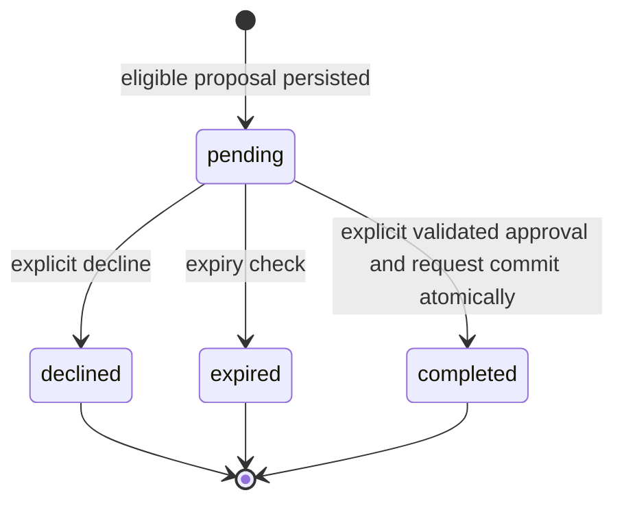

# ReturnPilot Database and State Model

**Status:** Proposed relational schema. PostgreSQL is primary; SQLAlchemy models and Alembic migrations will be introduced during implementation.

## Conventions

Use PostgreSQL `UUID` primary keys generated by the application or database, `TIMESTAMPTZ` stored in UTC, explicit foreign keys, and SQLAlchemy enums or constrained text values with migrations. Monetary fields are out of MVP scope. JSONB is reserved for a versioned, validated proposal snapshot and structured audit metadata, not a substitute for relational links. Synthetic order fixtures are loaded idempotently by a later seed process. All workflow records persist across restarts.

## Tables

### `demo_users`

| Column | Type | Constraints/notes |
|---|---|---|
| `id` | UUID | PK |
| `display_name` | VARCHAR(100) | NOT NULL |
| `session_key_hash` | VARCHAR(255) | NOT NULL, UNIQUE; do not store a raw session secret |
| `created_at` | TIMESTAMPTZ | NOT NULL, UTC |

MVP may use one seeded demo identity. Future production authentication is out of scope.

### `orders`

| Column | Type | Constraints/notes |
|---|---|---|
| `id` | UUID | PK |
| `owner_id` | UUID | NOT NULL FK `demo_users.id` |
| `external_order_ref` | VARCHAR(80) | NOT NULL; unique per owner (`owner_id`, value) |
| `ordered_at` | TIMESTAMPTZ | NOT NULL |
| `delivered_at` | TIMESTAMPTZ NULL | |
| `delivery_status` | VARCHAR(30) | NOT NULL, constrained known demo values |
| `created_at` | TIMESTAMPTZ | NOT NULL |

Indexes: `(owner_id, ordered_at DESC)`, `(owner_id, external_order_ref)` (unique constraint supplies lookup index).

Declare `UNIQUE (owner_id, id)` as a composite FK target for owner-scoped references; `id` remains the primary key.

### `order_items`

| Column | Type | Constraints/notes |
|---|---|---|
| `id` | UUID | PK |
| `order_id` | UUID | NOT NULL FK `orders.id` ON DELETE RESTRICT |
| `sku` | VARCHAR(100) | NOT NULL |
| `product_name` | VARCHAR(200) | NOT NULL |
| `description` | TEXT | nullable |
| `quantity` | INTEGER | NOT NULL CHECK `quantity > 0` |
| `condition_code` | VARCHAR(30) | NOT NULL, synthetic fixture value |
| `created_at` | TIMESTAMPTZ | NOT NULL |

Index `(order_id, sku)`; do not assume SKU unique across orders. Declare `UNIQUE (id, order_id)` as the composite FK target for proposal item/order consistency; `id` remains the primary key.

### `return_proposals`

| Column | Type | Constraints/notes |
|---|---|---|
| `id` | UUID | PK |
| `owner_id` | UUID | NOT NULL FK `demo_users.id` |
| `order_id` | UUID | NOT NULL FK `orders.id` ON DELETE RESTRICT |
| `order_item_id` | UUID | NOT NULL FK `order_items.id` ON DELETE RESTRICT |
| `resolution` | VARCHAR(30) | NOT NULL; MVP value `replacement` |
| `state` | VARCHAR(24) | NOT NULL: `pending`, `declined`, `expired`, `completed` |
| `action_snapshot` | JSONB | NOT NULL, versioned canonical representation of exact action shown to user |
| `policy_result` | JSONB | NOT NULL structured decision/reasons/rule version |
| `expires_at` | TIMESTAMPTZ NULL | optional policy expiry; after expiry approval rejects |
| `created_at` | TIMESTAMPTZ | NOT NULL |
| `updated_at` | TIMESTAMPTZ | NOT NULL |

Declare `UNIQUE (id, owner_id)` as a composite FK target for approval/request ownership references; `id` remains the primary key. Use composite FK `(owner_id, order_id)` to `orders(owner_id, id)` so proposal owner must match order owner, and composite FK `(order_item_id, order_id)` to `order_items(id, order_id)` so the item belongs to that order. The referenced composite keys are declared unique above. These are database-enforced; services must still enforce that the trusted actor is the owner and that proposal policy/state rules permit the operation. The frontend displays the action represented by this exact persisted snapshot; assistant prose is not authoritative. Index `(owner_id, created_at DESC)`, `(order_id, order_item_id)`, `(state, expires_at)`.

The snapshot is a JSON object with an integer `snapshot_version`, string `order_id`, `order_item_id`, and `resolution`, and an ordered array of string `conditions` representing the exact action and applicable conditions shown to the user. Canonicalize recursively with object keys sorted lexicographically, strings normalized to Unicode NFC, arrays kept in their defined display order, compact JSON separators, and UTF-8 encoding; the defined snapshot schema uses no floating-point values. Include every schema field in canonical form; optional fields are present with explicit JSON `null` rather than omitted. The backend computes SHA-256 over the resulting canonical UTF-8 bytes and returns the `snapshot_version` and 64-character lowercase hexadecimal `snapshot_hash` with proposal data for the frontend to display. The version is part of the canonical representation and covered by the digest. The frontend sends the displayed `snapshot_version` and `snapshot_hash` with the approval request; these identify the snapshot version the UI received and are not authorization credentials.

### `approval_records`

| Column | Type | Constraints/notes |
|---|---|---|
| `id` | UUID | PK |
| `proposal_id` | UUID | NOT NULL FK `return_proposals.id` ON DELETE RESTRICT, UNIQUE (one decision record per proposal) |
| `owner_id` | UUID | NOT NULL FK `demo_users.id` |
| `decision` | VARCHAR(16) | NOT NULL: `approved` or `declined` |
| `action_snapshot_hash` | VARCHAR(64) | NOT NULL; 64 lowercase hexadecimal characters containing the SHA-256 digest of the canonical versioned snapshot shown to the user |
| `decided_at` | TIMESTAMPTZ | NOT NULL |
| `actor_type` | VARCHAR(16) | NOT NULL, MVP `user`; never `llm` |

Declare `UNIQUE (proposal_id, owner_id)` as a composite FK target and use FK `(proposal_id, owner_id)` to `return_proposals(id, owner_id)` to enforce matching proposal ownership. Keep the unique `proposal_id` constraint to prevent multiple decision records, and declare `UNIQUE (id, proposal_id)` as the composite FK target for a request's approval/proposal pair. These relations are database-enforced. A repeated approval after successful commit returns the existing request only after validating the trusted actor and ownership, `approved` decision, proposal/request relationship, snapshot integrity, and `completed` proposal state. A repeated decline returns the existing declined outcome only when the authorized owner is repeating that same valid decision and the proposal is declined with no request; a conflicting decision is rejected.

### `return_requests`

| Column | Type | Constraints/notes |
|---|---|---|
| `id` | UUID | PK (persisted request ID shown to user) |
| `proposal_id` | UUID | NOT NULL FK `return_proposals.id` ON DELETE RESTRICT, UNIQUE (at most one request per proposal) |
| `approval_id` | UUID | NOT NULL FK `approval_records.id` ON DELETE RESTRICT, UNIQUE |
| `owner_id` | UUID | NOT NULL FK `demo_users.id` |
| `status` | VARCHAR(24) | NOT NULL: `submitted`, later demo status values only if implemented |
| `created_at` | TIMESTAMPTZ | NOT NULL |
| `updated_at` | TIMESTAMPTZ | NOT NULL |

Use composite FK `(proposal_id, owner_id)` to `return_proposals(id, owner_id)` to enforce that request owner matches proposal owner, and composite FK `(approval_id, proposal_id)` to `approval_records(id, proposal_id)` to enforce that the referenced approval belongs to that same proposal. The referenced composite keys are declared unique above. Keep `UNIQUE (proposal_id)` as the final duplicate-request defense and retain `UNIQUE (approval_id)`. `proposal_id` is the primary idempotency key for simulated request creation; no separate idempotency table or client-key mechanism is used. These relations and uniqueness rules are database-enforced; services must still verify the trusted actor owns the records, the approval decision is `approved`, and the proposal is in the valid state before creating or returning a request. Indexes `(owner_id, created_at DESC)` and `(owner_id, status)`.

### `audit_events`

| Column | Type | Constraints/notes |
|---|---|---|
| `id` | UUID | PK |
| `owner_id` | UUID NULL | FK `demo_users.id`; null only for system-level events |
| `proposal_id` | UUID NULL | FK `return_proposals.id` |
| `request_id` | UUID NULL | FK `return_requests.id` |
| `event_type` | VARCHAR(50) | NOT NULL; required types: `proposal_created`, `approval_recorded`, `request_created`, `proposal_declined`, `proposal_expired`, `request_status_checked` |
| `occurred_at` | TIMESTAMPTZ | NOT NULL |
| `details` | JSONB | NOT NULL default `{}`; allowlisted minimal outcomes/codes and identifiers not already represented by columns; no secrets, raw session tokens, chain-of-thought, full snapshots, or unnecessary duplicated sensitive data |
| `correlation_id` | UUID NULL | API/MCP operation correlation |

Indexes `(owner_id, occurred_at DESC)`, `(proposal_id, occurred_at)`, `(request_id, occurred_at)`.

Required successful-operation events are `proposal_created`, `approval_recorded`, `request_created`, `proposal_declined`, `proposal_expired`, and `request_status_checked`. `approval_recorded` records the decision outcome (`approved` or `declined`); it is not itself proof that a request exists.

## Relationships and ownership

One demo user owns many orders, proposals, approvals, requests, and events. An order has many items. Composite foreign keys enforce that a proposal's owner matches its order's owner and that its item belongs to the referenced order. A composite foreign key enforces that an approval's owner matches its proposal. Composite foreign keys enforce that a request's owner matches its proposal and that its approval references that same proposal. Unique `proposal_id` constraints enforce at most one approval decision record and at most one request per proposal. These relational invariants are database-enforced. Service validation is still required for trusted-session identity and actor authorization; eligibility, expiry, pending/terminal state transitions; approval decision value and snapshot integrity; and the atomic approval/request workflow. Every read and mutation scopes through owner ID derived from trusted server session context, never a model-provided owner ID.

## State transitions

Durable proposal states are `pending`, `declined`, `expired`, and `completed`. There is no separately committed `approved` proposal state in the MVP: explicit approval, its approval record, the single simulated request, the proposal update to `completed`, and related audit events commit atomically. `completed` means that transaction persisted the request; it does not mean a physical replacement was shipped. `declined` and `expired` are terminal and can never subsequently create a request.

If the client loses the commit response or the database commit outcome cannot be established, the outcome is unknown; do not assume an `execution_uncertain` state can be persisted while PostgreSQL is unavailable. Reconcile by proposal ID and the unique request reference before retrying. If a committed request is found, verify its proposal/approval relationship and completed proposal state before reporting success. If the outcome remains unknown, keep the user-facing status neutral and do not claim success or retry request creation. A retry is safe only after reconciliation establishes that no request committed and the proposal remains valid and pending.

Invalid transitions include declined or expired to any other state, completed to any other state, decision by non-owner, approval of an ineligible proposal, and any second request for the same proposal.

## Transaction and idempotency behavior

Proposal creation transaction persists proposal and `proposal_created` audit event; they commit or roll back together, and proposal creation creates no request. Proposal ID is the idempotency key for simulated request creation, and unique `return_requests.proposal_id` is the final duplicate defense. Approval endpoint opens one PostgreSQL transaction and locks the proposal row (`SELECT ... FOR UPDATE`), serializing concurrent approval/decline attempts for that proposal. Before approval, the backend recomputes SHA-256 from the persisted `action_snapshot` using the canonicalization above and verifies that both its supported `snapshot_version` and computed hash match the `snapshot_version` and `snapshot_hash` submitted with the approval request. Reject approval if either value differs. The submitted values identify the snapshot version the UI received; they are not authorization credentials and do not prove what the user actually saw. Store the verified digest in `approval_records.action_snapshot_hash` within this same atomic transaction. This comparison detects stale or mismatched snapshots only; it does not replace independent checks of trusted actor and ownership, pending state, expiry, or current deterministic eligibility. For an explicit approval, that same transaction records exactly one approved decision, inserts exactly one request with that proposal ID, updates the proposal directly from `pending` to `completed`, and inserts `approval_recorded` and `request_created` audit events. Approval, request creation, proposal completion, and both related events commit or roll back together. A successful commit therefore leaves one approval record, exactly one associated request, a completed proposal, and the corresponding events. A rollback leaves no successful approval/request pair, completed proposal, or success events. Database uniqueness constraints on approval `proposal_id` and request `proposal_id` provide final protection against duplicate records if requests race or are retried.

After a successful approval commit, repeating the approval returns the existing request only after validating the trusted actor and ownership, approved decision, proposal/request relationship, snapshot integrity, and completed proposal state. Decline instead atomically records the declined decision, changes `pending` to terminal `declined`, and inserts `approval_recorded` and `proposal_declined`; those changes and events commit or roll back together. It never creates a request. Repeating that decline returns the existing outcome only for the same valid decision by the authorized owner, with declined state and no request. Any conflicting decision is rejected. Expiry moves a pending proposal to terminal `expired` and inserts `proposal_expired` in the same transaction; from that state no request can be created.

A successful request-status lookup is read-only with respect to request/proposal business state, but appends `request_status_checked` in the same transaction as the successful lookup result; return the result only after that event commits. Failed lookups or operations that fail or roll back must not insert an event asserting a successful business outcome. If a transaction fails, its associated business-state changes and success events roll back together. Failure-attempt logging is outside this MVP event set; no audit record may claim an approval, request, decline, expiry, or status result that was not successfully persisted or returned.

If the client loses the commit response or the commit outcome is unknown, reconcile by proposal ID and the unique request reference (the proposal ID) before retrying. Do not assume `execution_uncertain` can be persisted while PostgreSQL is unavailable. Return an existing request only after verifying its owner, proposal, approval, snapshot, and completed state. Retry request creation only after reconciliation confirms that no request committed and the proposal remains valid and pending. A request is never inferred from a proposal or approval alone, and no path may create a duplicate request.
## Status/history and retention

History is queried by trusted `owner_id`, ordered newest first, joining requests to proposal/order/item and loading request-related audit events in chronological order. Status reflects persisted `return_requests.status`; pending proposals are shown separately. All listed business and audit rows survive restarts. Synthetic seed orders are stable and idempotently upserted by owner plus external reference. Deletion/retention policy is not needed for this short-lived demo; production policy requires separate review.
